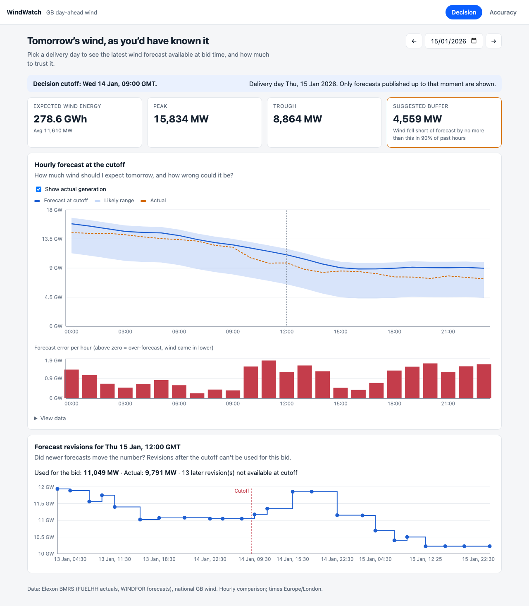
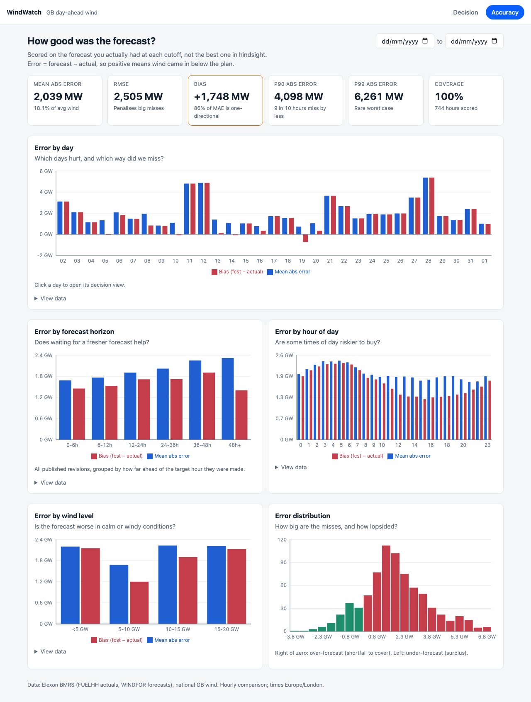

# WindWatch: day-ahead wind forecast decision support (GB)

A web app for a UK day-ahead power desk. For any delivery day it answers two questions:

1. **What is the latest wind forecast available when I must place my bid?** (the forecast published at or before the D-1 cutoff, not the latest one in hindsight)
2. **How accurate has that forecast been?** (MAE, RMSE, bias, P90/P99, sliced by day, horizon, hour and wind level) plus a **suggested MW buffer** derived from past errors.

Scope: national GB wind only. Actuals from Elexon `FUELHH` (`fuelType=WIND`), forecasts from `WINDFOR`. Decisions made in **January 2026** → delivery days 2 Jan – 1 Feb 2026.

| | |
|---|---|
| **Live app** | _add Vercel URL_ (open, no login) |
| **Video** | _add unlisted YouTube URL_ |




## What January shows

(`make analyse`, reproduced from the snapshot)

- Mean absolute error **2,039 MW (18% of average wind)**, P90 **4.1 GW**.
- Bias is **+1,748 MW**: the forecast was systematically above actual, and that accounts for **86% of MAE**. Removing the mean bias would cut MAE to ~1,376 MW (-33%).
- Error grows with lead time: **14.8% nMAE** for forecasts 0–6 h ahead → **20%** at 36–48 h.
- Worst day 28 Jan: every hour over-forecast, ~5.4 GW.
- The bias is the same size at every horizon, which suggests a definitional or calibration offset between the two Elexon series rather than weather skill. That is a hypothesis to confirm with the data owner, not a finding.

## Run it

**Docker** (nothing else needed):
```bash
docker compose up --build                  # app http://localhost:8080, API http://localhost:8077/docs
                                           # local login: demo / demo-password (override via .env)
docker compose --profile dev up --build    # adds Vite hot-reload frontend on http://localhost:5173
scripts/smoke.sh http://localhost:8080     # checks data is blocked without login, then logs in
```
Port clash? `DEV_PORT=5174 docker compose --profile dev up` moves the dev frontend; the API is published on 8077 because 8000 is commonly taken.

**Local dev** (Python 3.12 via [uv](https://docs.astral.sh/uv/), Node 22):
```bash
make install
make dev        # API :8077, UI :5173 (Vite proxies /api to :8077); login demo / demo-password
make test       # backend + frontend tests
make lint       # ruff, mypy --strict, eslint, tsc
make ingest     # optional: re-pull the snapshot from Elexon
```
API docs (Swagger): `http://localhost:8077/docs`.

## Layout

```
backend/
  app/
    domain/        pure pandas logic, no I/O: selection.py (cutoff + decision-time forecast),
                   metrics.py, risk.py (band + buffer)
    ingestion/     elexon.py (async client, retry, chunking), transform.py (validate/dedupe/hourly), pipeline.py
    services/      analytics.py: composes domain over a loaded snapshot
    api/           routes.py, schemas.py (public contract), auth.py (login, session guard),
                 middleware.py (request id, logs, ETag, errors)
    repository.py  DataRepository protocol + CSV implementation (the DB seam)
    core/          settings (fail-closed auth config), JSON logging, security.py (signed tokens)
  scripts/         ingest.py, analyse.py, export_openapi.py
  tests/           domain, ingestion, API, contract snapshot
frontend/src/
  api/             typed client, TanStack Query hooks, types generated from openapi.json
  pages/           DecisionPage, AccuracyPage     charts/  Recharts components
  components/ lib/ shared UI and formatters
data/              committed snapshot: forecasts.csv, actuals.csv, manifest.json
api/index.py       Vercel serverless entrypoint     vercel.json  routing + bundle config
openapi.json      API contract (CI fails if stale)
assets/            README screenshots
```

## How it works

```
Elexon API ─ingest─▶ data/*.csv ─▶ CsvRepository ─▶ AnalyticsService ─▶ FastAPI /api/v1 ─▶ React
                    (offline)       (DB seam)         (domain/ pure fns)
```

- **Decision-time forecast:** for target hour T on delivery day D, take the row with the greatest `publishTime ≤ cutoff(D)`, where cutoff = **D-1 09:00 Europe/London** (configurable). Hours with no such forecast are reported as missing, never filled.
- **Error** = forecast − actual (positive = over-forecast = shortfall to cover). Compared hourly: actual is the mean of the two half-hours.
- **Risk band / buffer:** quantiles of past signed errors (central 80% → P10..P90). **No look-ahead:** at D-1 09:00 day D-1 is unfinished, so only days ≤ D-2 are used. Hidden until 3 usable days exist, with the reason shown in the UI. Buffer = P90 over-forecast, floored at 0.
- **Horizon analysis** scores every published revision, not just the one used for the bid, to show whether waiting for a fresher forecast helps.

### Assumptions to confirm with the product owner

| Topic | Assumption |
|---|---|
| Cutoff | D-1 09:00 Europe/London (`DECISION_CUTOFF_LOCAL`); the real auction gate may differ |
| "January" | Decision date, so delivery days are 2 Jan – 1 Feb |
| Grain / units | Hourly, MW (power, not energy); actual = mean of the two half-hours; partial hours dropped |
| Missing data | Excluded from metrics, coverage reported |
| Band | 80% central interval (P10–P90) of past errors, days ≤ D-2 only |
| Bias | +1.7 GW at every horizon, likely a series-definition offset; unverified |

## Engineering practices

- **Tests:** 79 backend (domain edge cases incl. cutoff boundary, DST, leakage guard; ingestion with mocked HTTP incl. retry; API contract; auth: token tampering/expiry, every data route returns 401 signed-out, cookie flags), 16 frontend (formatters, CSV export, page states, sign-in/expiry flows with a mocked API). Domain coverage ≥ 96%.
- **Static checks:** `ruff`, `mypy --strict`, `eslint`, `tsc --strict`; CI (`.github/workflows/ci.yml`) also checks that `openapi.json` and the generated TS types match the code, builds the Docker images and runs the smoke test.
- **API design:** versioned `/api/v1`, typed pydantic responses with units in field names, one error envelope `{error:{code,message,request_id}}`, `ETag`/304 keyed on the data version, OpenAPI contract committed.
- **Observability:** JSON logs with request id and latency, `X-Request-ID` echoed, public `/health` and authenticated `/ready` (data version + row counts), ingestion logs counts and drops.
- **Frontend:** server state in TanStack Query (previous data stays visible while refetching), view state in the URL (shareable deep links), route-level code splitting, linked charts, accessible data-table fallback for every chart, dark-mode aware.
- **Ingestion safety:** retries with backoff on 429/5xx, atomic file writes, idempotent snapshot with content-hash version.

## Access control

Login is **optional**. The deployed app is open (`AUTH_ENABLED=false`). With `AUTH_ENABLED=true` the whole product sits behind a login: one shared credential from `AUTH_USERNAME` / `AUTH_PASSWORD`, a signed (HMAC-SHA256) `HttpOnly`, `SameSite=Lax` session cookie (`Secure` over HTTPS, 12 h), stateless so it works on serverless. Every data endpoint then returns `401` without a session; only `/api/v1/health` is public. The app refuses to start with auth enabled but credentials or a ≥32-char `SESSION_SECRET` missing. Docker Compose and `make dev` run with login on (`demo` / `demo-password`). Limits: single shared account, no rate limiting beyond a delay on failed logins.

## Deploy (Vercel)

One project, repo root as the root directory: static frontend + the FastAPI app as a Python function (`api/index.py`), data bundled read-only. Measured locally: runtime dependencies 80 MB (limit 250 MB), cold import ≈ 0.4 s with warm bytecode. Set one environment variable in Vercel → Settings → Environment Variables, then deploy:

| Variable | Value |
|---|---|
| `AUTH_ENABLED` | `false` for an open app. To require login instead, set `true` plus `AUTH_USERNAME`, `AUTH_PASSWORD` and `SESSION_SECRET` (`openssl rand -hex 32`) |

Verify (adapts to open or login mode; with login on, pass `SMOKE_USER` and `SMOKE_PASSWORD`):
```bash
scripts/smoke.sh https://<your-app>.vercel.app
```

## Known limits / next steps

- Serving a static snapshot; live refresh would run `ingest` on a schedule and swap in a database-backed `DataRepository`.
- The band is a pooled empirical error quantile; conditioning on hour or wind level would tighten it.
- Single shared login (no per-user accounts / SSO), no demand/price data (out of scope by brief).

## AI usage disclosure

AI coding assistance (an LLM pair-programming tool) was used for planning, scaffolding, writing code and tests, and drafting docs. I reviewed the design decisions and checked outputs against the live Elexon data (row counts, cutoff behaviour, headline metrics) and against the test suite.
